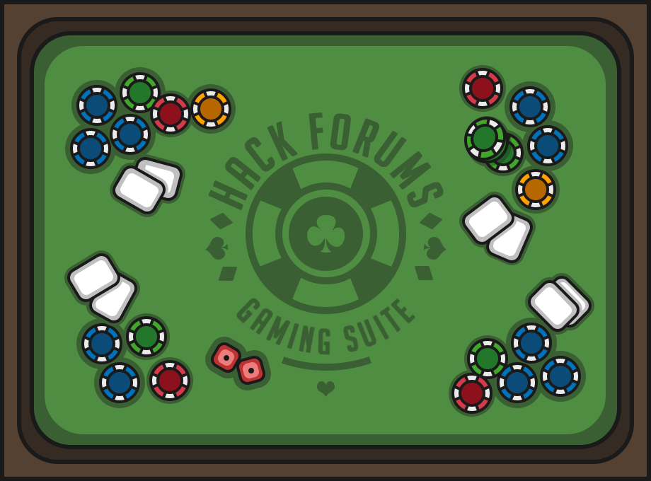

<div align="center">
  <h1>HF Gaming Suite</h1>
  Bots, stats and history for Hack Forums' βytes games: blackjack and slots
  <br>
  <br>
  
  <br>
  <a href="https://chrome.google.com/webstore/detail/hf-gaming-suite/gkncdlncbppkmojddfcncglmelgljcal">
    
  </a>
</div>

## What it does

HFGS adds a panel under each game on Hack Forums with a bot, live stats for this visit and overall, a chart of your βytes over recent results, and your recent results. Hands and spins you play yourself count too. βytes are Hack Forums' internal points; they have no cash value.

- **Blackjack** plays every hand by basic strategy for HF's table rules (dealer hits soft 17, double any two cards, one split, late surrender). The strategy is a lookup table built into the extension, matched against the published basic strategy chart. Optional martingale betting with a bet cap. With martingale on, each set (from your bet up to the win that ends it) counts as one round, so a losing set plays on past your Rounds setting until it wins or a stop-loss, take-profit or Stop ends it. While it's on, a Martingale section tracks the set in progress (next bet, distance to the cap) and how the sets of the latest run ended: recovered, won short at the cap, or abandoned when the run ended first. The results start over with each run.
- **Strategy assistant** (blackjack): beside the table, the strategy table's inputs (your cards, the dealer's upcard, what HF offers) and output (the best play and every option's expected value), with bust odds and the chart row, live for the bot's hands and your own. Your own decisions are checked against the table.
- **Slots** spins at a fixed bet, using HF's own bet steps, and never bets more than your credits.
- **Hack Game** plays Small Hack Jobs: the job you pick in HF's own list, which HFGS remembers and keeps selected (if HF renames or removes it, it's forgotten and you're told). Press Start on any Hack Game page and it plays whenever the cooldown is over, after a random extra wait, pauses when power runs low and starts again by itself once the battery has recharged. With **Run in background** on, it plays with no HF tab open as long as the browser is running; off (the default), a run plays from an open Hack Game page. A **status card** in the corner of every HF page shows what a run is doing with a live countdown; with Run in background off and nothing running, it has a **Hack** button that plays your job once and then shows Success or Fail and the time until the next job. The card can be made compact, shrunk to a pill (still with its ▶ button), or turned off. It sits bottom right, or bottom left when [HF Convo Anywhere](https://github.com/xadamxk/HF-Convo-Anywhere)'s chat dock is on the right, so the two never overlap.
- **Limits for every session:** a number of hands or spins (or run until stopped), stop-loss, take-profit, and a confirmation before any bet is placed. Blackjack and slots each have their own limits, Headless Mode, sound and action delay settings.
- **Gentle on HF:** one request at a time, at least 2 seconds apart by default. HF's flood control ("submitting too quickly") is detected and retried, and anything unexpected stops the bot instead of guessing.
- **Headless Mode** (on by default) plays in the background and only updates HF's balance. Turn it off to watch the bot play with HF's own card and reel animations.
- **History:** every result, whether the bot or you played it, is kept in your browser, with totals per game on the settings page and CSV/JSON export.

Change settings right on the game page, in the panel's **Settings** section, or on the settings page (toolbar button or the panel's **Settings** link). Either way they save at once, show up on the other, and apply from the next round, even while the bot runs.

## Install

- **Chrome:** [Chrome Web Store](https://chrome.google.com/webstore/detail/hf-gaming-suite/gkncdlncbppkmojddfcncglmelgljcal)
- **Firefox (140+):** coming to Firefox Add-ons. Until then, see [BUILDING.md](BUILDING.md).

## Privacy

HFGS only talks to Hack Forums, and keeps your settings and history in your browser. The developer receives no data. See [PRIVACY.md](PRIVACY.md).

## Development

```bash
npm ci
npm run dev          # build to dist/ and rebuild on changes
npm test             # Jest
npm run typecheck
npm run lint
npm run package      # release zips in releases/ (Chrome, Firefox, Firefox source)
```

Load `dist/` as an unpacked extension (Chrome: `chrome://extensions`, Developer mode, **Load unpacked**).

`npm run browser` opens Chrome for Testing with `dist/` loaded and its own saved profile, so a Hack Forums sign-in survives restarts. Scripts can drive it on `127.0.0.1:9222`:

- `npm run probe` checks that every selector and page variable HFGS relies on still exists on the live pages (read-only).
- `npm run capture` records HF's game requests and responses into `fixtures/responses/` while you play by hand, with session tokens removed.

`npm run browser:firefox` does the same in Firefox, with the extension as a temporary add-on.

What HFGS knows about HF's games (endpoints, response shapes, table rules, flood control) is written up in [docs/phase0-findings.md](docs/phase0-findings.md), backed by the captured fixtures.

### Adding a game

1. Add `src/games/<game>/definition.ts`: name, page path, settings (the settings page is generated from them) and how to describe a result.
2. Add `src/games/<game>/engine.ts`: `playRound()` plays one round through `HfClient` and returns what was wagered and returned. The shared runner handles limits, stopping, history and the panel.
3. Register them in `src/games/registry.ts` and `src/games/bots.ts`, and add the page to both content scripts in `src/manifest.json` (a test checks they match).

The blackjack strategy table is generated by `npm run strategy:generate` from the rules at the top of `scripts/generate-strategy-table.js`.

## License

[GPL-3.0](LICENSE). HF Gaming Suite is not affiliated with or endorsed by Hack Forums.
